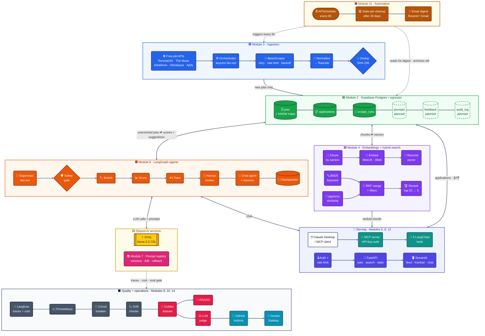
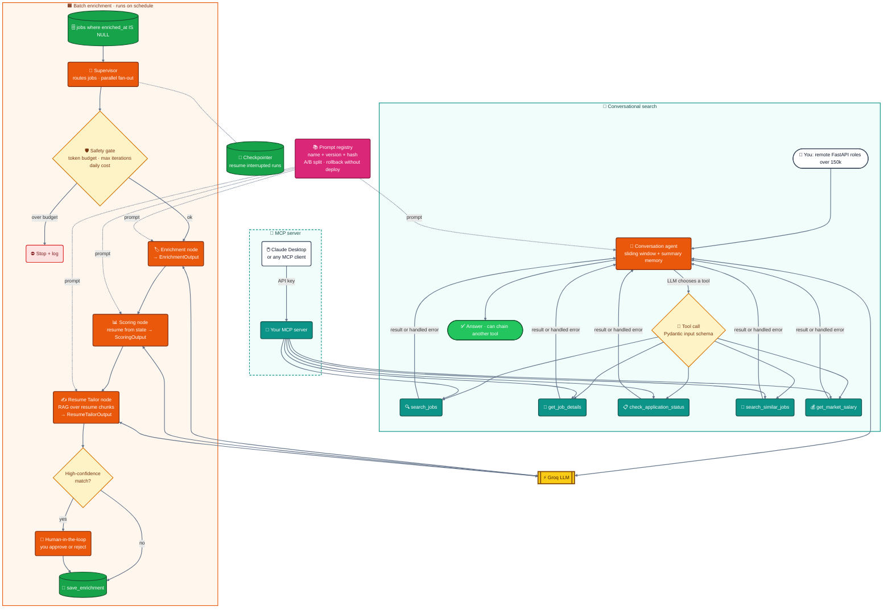
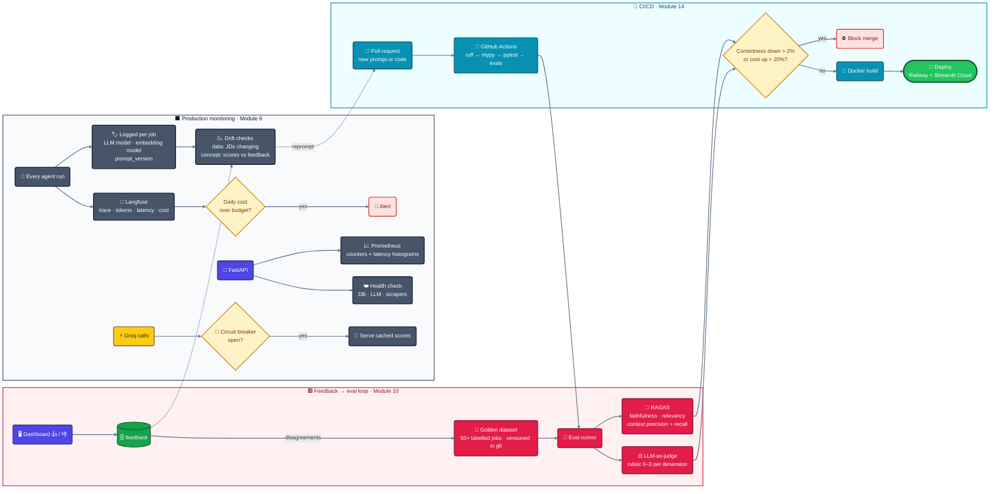

# AI Job Search Aggregator

AI-powered job aggregator — pulls jobs from free job APIs (RemoteOK, The Muse,
Arbeitnow, Himalayas) every 6 hours, scores every job against your resume using
LangGraph agents, and surfaces the best matches in a Streamlit dashboard.

**Stack:** FastAPI · LangGraph · LangChain · Groq (free LLM) · Supabase ·
pgvector · Playwright · Apify · Sentence Transformers · Langfuse · APScheduler · Streamlit

---

## Architecture

Four diagrams, from the big picture down. Each box is labelled with the module
that builds it — see [Course Modules](#course-modules) for status. Only
Modules 1–2 exist so far; everything else is the plan.

**Colour key (same in every diagram):**
🟦 Ingestion · 🟩 Database · 🟪 Embeddings + search · 🟧 Agents · 🩵 Tools + MCP ·
🩷 Prompts · 🟨 LLM · 🔵 API + UI · ⬛ Observability · 🟥 Evals · 🟫 Automation · 🔷 CI/CD.
Dashed boxes are planned tables that don't exist yet.

**Design choices (free-tools rule):** free job APIs instead of LinkedIn/Indeed
scraping · Resend or Gmail SMTP instead of SendGrid · a Postgres checkpointer
instead of Redis · salary tool uses stored job salaries instead of SerpAPI.

### 1. System architecture — every module



### 2. Job data flow — one job's lifecycle

```mermaid
%%{init: {"flowchart": {"curve": "basis", "nodeSpacing": 40, "rankSpacing": 45}, "themeVariables": {"fontFamily": "Segoe UI, Helvetica, Arial, sans-serif", "fontSize": "15px"}}}%%
flowchart TD
    A(["⏰ Scheduler fires every 6h"]) --> B("⚙️ Orchestrator fans out to scrapers<br/>RemoteOK · The Muse · Arbeitnow · Himalayas · Apify")
    B --> C("🧹 Normalize any source → RawJob")
    C --> D("🔑 dedup_hash = SHA-256 of title + company + location")
    D --> E{"Hash already<br/>in jobs?"}
    E -->|yes| X("⏭️ Skip · counted as duplicate in scrape_runs")
    E -->|no| F[("🗄️ Insert row · enriched_at = NULL")]

    F --> G{"🛡️ Safety gate<br/>within token + cost budget?"}
    G -->|no| W("⏸️ Wait for next run")
    G -->|yes| H("🏷️ Enrichment Agent<br/>skills · seniority · remote · salary")
    H --> I("📊 Scoring Agent<br/>match_score 0–100 vs your resume")
    I --> J("✍️ Resume Tailor Agent<br/>RAG over resume chunks → bullets + ATS keywords")
    J --> K[("💾 save_enrichment<br/>+ LLM model · prompt_version · tokens · cost")]

    K --> L("🔢 Chunk JD by section → batch embed → save_embedding")
    L --> M{"match_score<br/>≥ 75?"}
    M -->|yes| N("📧 Email digest + high-confidence review")
    M -->|no| O("🔍 Searchable only")
    L --> P("🔀 Hybrid search<br/>BM25 + vector → RRF → rerank")
    N --> Q("🖥️ Seen in dashboard · chat · MCP clients")
    O --> Q
    P --> Q

    Q --> R("👍👎 Feedback → golden dataset")
    Q --> S("📋 saved → applied → screening → interview")
    S --> T{"Outcome"}
    T --> U(["🎉 offer"])
    T --> V(["rejected / withdrawn"])
    F -.->|"older than 30 days"| Z("🗑️ Archived by stale-job cleanup")

    classDef auto fill:#B45309,stroke:#78350F,color:#fff,stroke-width:2px
    classDef ingest fill:#2563EB,stroke:#1E3A8A,color:#fff,stroke-width:2px
    classDef db fill:#16A34A,stroke:#14532D,color:#fff,stroke-width:2px
    classDef agent fill:#EA580C,stroke:#7C2D12,color:#fff,stroke-width:2px
    classDef rag fill:#7C3AED,stroke:#4C1D95,color:#fff,stroke-width:2px
    classDef serve fill:#4F46E5,stroke:#312E81,color:#fff,stroke-width:2px
    classDef eval fill:#E11D48,stroke:#881337,color:#fff,stroke-width:2px
    classDef decide fill:#FEF3C7,stroke:#D97706,color:#78350F,stroke-width:2px
    classDef bad fill:#FEE2E2,stroke:#DC2626,color:#7F1D1D,stroke-width:2px
    classDef good fill:#22C55E,stroke:#14532D,color:#fff,stroke-width:3px
    classDef muted fill:#F1F5F9,stroke:#64748B,color:#334155,stroke-width:2px

    class A,N,Z auto
    class B,C,D ingest
    class F,K db
    class H,I,J agent
    class L,P rag
    class Q,S serve
    class R eval
    class E,G,M,T decide
    class X,W,V bad
    class U good
    class O muted
    linkStyle default stroke:#64748B,stroke-width:2px
```



### 3. Agents, tools and MCP — Modules 5, 6, 7



### 4. Evaluation, feedback and MLOps — Modules 9, 10, 14



---

## Quickstart (Windows — uv)

### 1. Install uv (once, global)
```powershell
powershell -ExecutionPolicy ByPass -c "irm https://astral.sh/uv/install.ps1 | iex"
```
Restart your terminal after installing.

### 2. Clone / copy project
```powershell
cd C:\Projects
# if using git:
git clone https://github.com/sureshkunku/ai-job-search.git
cd ai-job-search

# or just copy the folder here
```

### 3. Create virtual environment + install deps (uv does both in one step)
```powershell
uv sync
```
This creates `.venv\` and installs all dependencies. Much faster than pip.

### 4. Install dev dependencies too
```powershell
uv sync --dev
```

### 5. Copy env file and fill in your keys
```powershell
copy .env.example .env
# open .env in PyCharm and fill in keys (see Free Keys section below)
```

### 6. Run tests (Modules 1–2 — no API keys needed, the DB is mocked)
```powershell
uv run pytest backend/tests -v
```

### 6b. Create the database tables (once)
Open your Supabase project → **SQL Editor**, paste in `scripts/setup_db.sql`, and run it.

### 7. Run the app (Module 5+)
```powershell
uv run uvicorn backend.main:app --reload
```

---

## Get Your Free API Keys

| Service | URL | What it's for | Free tier |
|---------|-----|----------------|-----------|
| Groq | https://console.groq.com | LLM (Llama 3.3 70B) — key starts with `gsk_` | Free tier |
| Supabase | https://supabase.com | Postgres + pgvector | 500MB free |
| Apify | https://apify.com | Extra job scraping | Free monthly credit |
| Langfuse | https://cloud.langfuse.com | LLM tracing | Free cloud |
| Resend or Gmail SMTP | https://resend.com | Email digest (Module 11) | Free tier |

RemoteOK, The Muse, Arbeitnow and Himalayas need **no API keys**.

---

## Project Structure

```
ai-job-search/
├── backend/
│   ├── config.py          # all settings (pydantic-settings)
│   ├── main.py            # FastAPI app
│   ├── models/            # Pydantic data models
│   ├── api/               # FastAPI route handlers
│   ├── scrapers/          # RemoteOK, The Muse, Arbeitnow, Himalayas, Apify
│   ├── agents/            # LangGraph AI agents
│   ├── db/                # Supabase repository layer
│   ├── scheduler/         # APScheduler jobs
│   ├── notifications/     # Email digest (Resend / Gmail SMTP)
│   └── tests/             # Pytest test suite
├── frontend/
│   └── app.py             # Streamlit dashboard
├── scripts/
│   └── setup_db.sql       # Supabase schema
├── data/
│   └── resume.txt         # YOUR resume (gitignored)
├── pyproject.toml
└── .env.example
```

---

## Course Modules

| Module | Topic | Status |
|--------|-------|--------|
| 1 | Project foundation, Pydantic models, Config | ✅ Done |
| 2 | Supabase schema, pgvector, Repository pattern | ✅ Done |
| 3 | Scrapers (RemoteOK, The Muse, Arbeitnow, Himalayas, Apify) | 🔄 Next |
| 4 | Embeddings, RAG, BM25, Hybrid search | ⏳ |
| 5 | Tool calling, MCP server | ⏳ |
| 6 | LangGraph agents (Enrichment, Scoring, Tailor) | ⏳ |
| 7 | Prompt engineering + versioning | ⏳ |
| 8 | FastAPI backend | ⏳ |
| 9 | Observability (Langfuse, MLOps) | ⏳ |
| 10 | Eval framework (RAGAS, golden dataset) | ⏳ |
| 11 | Scheduler + automation + email digest | ⏳ |
| 12 | Streamlit dashboard | ⏳ |
| 13 | Testing (pytest, mocking, eval suite) | ⏳ |
| 14 | CI/CD + Deploy | ⏳ |
